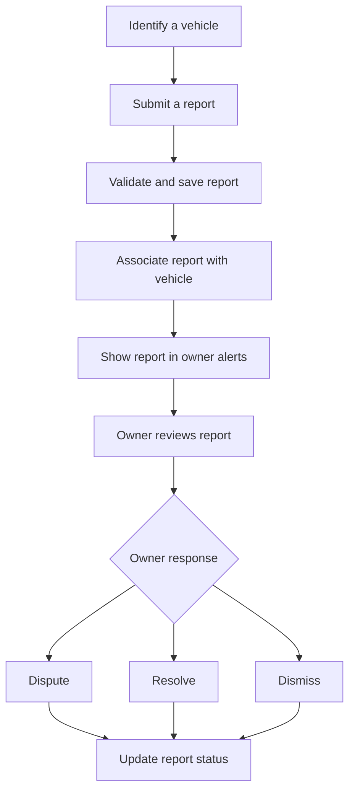
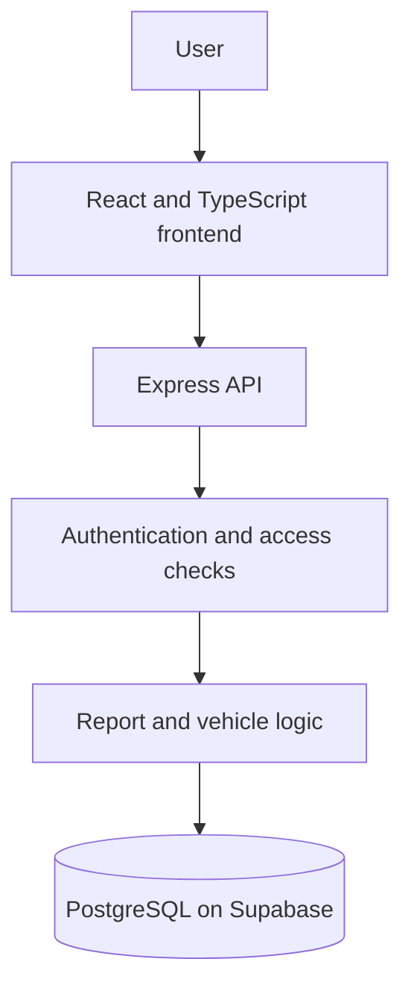

# Driver Ping

<p align="center">
  <strong>Vehicle reporting. Clearer follow-up.</strong>
  <br />
  A web application prototype connecting vehicle-related reports with an owner review workflow.
  <br /><br />
  
  
  
  
</p>

<p align="center">
  Built by <strong>Team Efficient Solutions</strong> for the FNB App of the Year Hackathon 2026.
</p>

---

## Contents

- [Overview](#overview)
- [The problem](#the-problem)
- [How it works](#how-it-works)
- [System architecture](#system-architecture)
- [Features and implementation status](#features-and-implementation-status)
- [Technology stack](#technology-stack)
- [Project structure](#project-structure)
- [Getting started](#getting-started)
- [Environment configuration](#environment-configuration)
- [Development checks](#development-checks)
- [Roadmap](#roadmap)
- [Responsible use](#responsible-use)
- [Team](#team)

## Overview

Driver Ping is a vehicle reporting prototype built around a simple idea: submitting a report should be the beginning of a clear process, not the end of one.

The application provides an interface for looking up vehicle registration numbers, submitting reports, and viewing vehicle-related information. Its intended workflow connects a report with an owner-facing alerts experience, where the owner can review the report and respond through the available actions.

The project is being developed with a React and TypeScript frontend, an Express backend, and PostgreSQL for persistent data.

## The problem

Vehicle-related concerns can be difficult to communicate to the relevant person. Without a clear follow-up process, the person submitting a report may not know what happened, while the vehicle owner may have limited opportunity to respond.

Driver Ping explores a more structured process:

- Make vehicle reporting straightforward.
- Connect reports to the relevant vehicle and owner.
- Give owners a way to review and respond.
- Make report status easier to follow.
- Build the application around consistent data handling and appropriate access controls.

The aim is better communication and accountability, not to treat every submitted report as a proven allegation.

## How it works




## System architecture




**Architecture notes**

- **Frontend:** Renders the application screens and collects user input.
- **Backend:** Handles API requests and application logic.
- **Database:** Stores application records that need to persist between sessions.
- **Authentication and access controls:** Must be enforced by the backend and database, not just by hiding interface elements.

The diagram is a logical overview, not a guarantee that every security control or data flow has been independently verified.

## Features and implementation status

The repository contains the following application areas. Their presence in the code does not, by itself, prove that every feature is fully operational in a deployed environment.

| Area | Purpose | Verification needed |
|---|---|---|
| Vehicle lookup | Find a vehicle using registration information | Confirm lookup behaviour and data source |
| Report submission | Capture vehicle-related reports | Test validation and database persistence |
| Report categories | Organise the types of concerns being reported | Confirm available categories |
| Owner alerts | Present reports associated with an owner | Test vehicle-to-owner matching |
| Report responses | Support actions such as dismissing, disputing, or resolving | Test permissions and status transitions |
| Sign-in | Provide access to the application | Test authentication and session handling |
| Backend API | Process application requests | Run API and integration tests |
| PostgreSQL schema | Define persistent application data | Verify migrations, constraints, and live connection |


## Technology stack

| Technology | Purpose |
|---|---|
| React | User interface |
| TypeScript | Type-safe application development |
| Vite | Frontend development and build tooling |
| Node.js | JavaScript runtime |
| Express | Backend API |
| PostgreSQL | Relational database |
| Supabase | Hosted PostgreSQL infrastructure |
| Git and GitHub | Source control and collaboration |

## Project structure

```text
Driver-Ping/
├── scripts/
│   ├── verify-backend.ts
│   └── verify-supabase-connection.ts
├── src/
│   ├── components/       # Reusable UI components
│   ├── constants/        # Report categories and plate data
│   ├── context/          # Shared application state
│   ├── db/
│   │   └── schema.sql    # Database schema
│   ├── screens/          # Main application screens
│   ├── server/
│   │   ├── api.ts        # API routes and request handling
│   │   └── db.ts         # Database access
│   ├── types/            # Shared TypeScript types
│   ├── App.tsx
│   ├── index.css
│   └── main.tsx
├── .env.example
├── .gitignore
├── index.html
├── package.json
├── server.ts
├── tsconfig.json
└── vite.config.ts
```

This layout reflects the project files currently identified in the repository; individual filenames or scripts may change as development continues.

## Getting started

### Prerequisites

- [Node.js](https://nodejs.org/) compatible with the project's dependencies
- npm
- Access to a PostgreSQL database for backend functionality

### 1. Clone the repository

```bash
git clone <repository-url>
cd Driver-Ping
```

Replace `<repository-url>` with the repository's actual GitHub URL.

### 2. Install dependencies

```bash
npm install
```

### 3. Configure the environment

Create a local `.env` file using `.env.example` as a reference. Follow the variable names and requirements defined by the current server code.

### 4. Start the application

Check the scripts in `package.json` before starting the frontend and backend.

For the Vite development server, if the `dev` script is configured:

```bash
npm run dev
```

If the backend has a separate development script, run it in another terminal. The frontend and backend must be configured to communicate with each other.

### 5. Verify the application

- Confirm that the frontend starts without errors.
- Check the backend's startup output.
- Verify the database connection.
- Submit a test report using a demo account.
- Sign in as the intended owner and check whether the report appears.
- Test the available report responses.
- Restart the application and check that saved data persists.

Use test data rather than real people's personal information during development.

## Environment configuration

Keep credentials in your local `.env` file or the hosting provider's environment settings.

Example variable names may include:

```env
DATABASE_URL=your_postgresql_connection_string
JWT_SECRET=your_development_signing_secret
```

These are illustrative examples, not a complete environment specification. Check `.env.example`, `server.ts`, and `src/server/db.ts` for the exact variables required by your current version.

## Responsible use

Driver Ping is a hackathon prototype. It is not an official vehicle registry, an emergency response service, or a substitute for law enforcement.

A submitted report should not automatically be treated as verified fact. Any public deployment requires careful consideration of privacy, access permissions, misuse prevention, data retention, and fair handling of disputed reports.

The project's selected hackathon challenge concerns safer communities and gender-based violence response. Vehicle reporting alone does not address the full scope of that challenge; the team should explain the project's actual contribution and limitations accurately.

## Team

**Team Efficient Solutions**  
FNB App of the Year Hackathon 2026

Built collaboratively, with a focus on a clear reporting workflow, reliable data handling, and practical implementation.

---

<p align="center">
  <sub>Driver Ping - a work in progress. Features and integrations should be verified against the current code and deployment.</sub>
</p>
